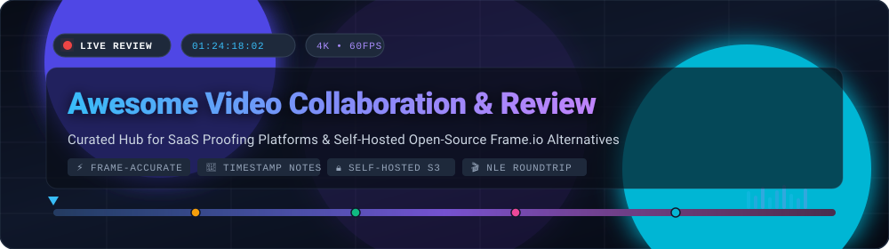
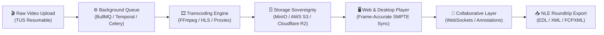
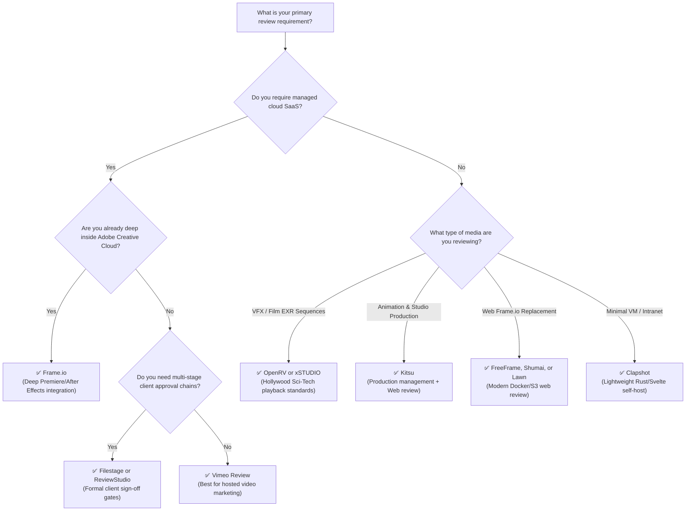

  

  
  
  
  
  
  
  

---

# 🎬 Awesome Video Collaboration &amp; Review Platforms

> 🚀 **The definitive curated directory of SaaS video proofing platforms and self-hosted, open-source Frame.io alternatives for filmmakers, post-production teams, animation studios, VFX houses, and creative agencies.**

Modern creative workflows replace the chaotic sprawl of email chains, timecode guesswork (*"around 1:42, maybe"*), and disconnected spreadsheets with **frame-accurate visual annotations**, **time-coded threaded discussions**, **side-by-side version comparison**, **client approval sign-offs**, and **NLE timeline roundtripping** (DaVinci Resolve, Adobe Premiere Pro, Final Cut Pro).

Whether you need a turn-key cloud SaaS ecosystem or an on-premise, self-hosted platform with complete S3 storage sovereignty, this repository tracks the best tools available.

---

## 📑 Table of Contents

- [🌐 Sector Overview &amp; Market Dynamics](#-sector-overview--market-dynamics)
- [💼 Top SaaS &amp; Commercial Review Platforms](#-top-saas--commercial-review-platforms)
- [🚀 Open-Source Video Review &amp; Collaboration Projects](#-open-source-video-review--collaboration-projects)
- [📊 Feature Comparison: SaaS vs. Self-Hosted](#-feature-comparison-saas-vs-self-hosted)
- [🏗️ Key Architectural &amp; Engineering Patterns](#️-key-architectural--engineering-patterns)
- [🎯 Decision Guide: Which Platform Fits Your Team?](#-decision-guide-which-platform-fits-your-team)
- [🤝 How to Contribute](#-how-to-contribute)
- [📈 Star History](#-star-history)
- [📄 License &amp; Community Disclaimer](#-license--community-disclaimer)

---

## 🌐 Sector Overview &amp; Market Dynamics

The global video collaboration, media review, and cloud proofing software market was valued at **$3.8 Billion in 2024** and is projected to expand to **$8.6 Billion by 2030**, progressing at a Compound Annual Growth Rate (**CAGR of ~14.2%**). This accelerating demand is driven by distributed post-production teams, universal 4K/8K delivery specs, explosion of commercial digital video marketing, and tight deadlines across VFX, gaming, and television productions.

### 🔍 Market Structure &amp; Concentration
- **Tier 1 (Enterprise &amp; Suite Lock-In):** The upper market exhibits **moderate-to-high concentration**, led by Adobe (Frame.io) and Vimeo. Frame.io holds strong market capture among enterprise creative agencies and broadcast editors through deep native bundling in Premiere Pro and After Effects.
- **Tier 2 (Mid-Market &amp; Specialized Proofing):** The mid-tier remains **moderately fragmented**. Independent contenders such as Filestage, Wipster, ReviewStudio, and SyncSketch capture substantial market share by specializing in regulatory approval chains, multi-asset marketing proofing (video, PDF, live web), and interactive 3D/animation reviews.
- **Tier 3 (Open-Source &amp; Data-Sovereign Wave):** Rising per-seat SaaS costs, strict NDA client agreements, and cloud storage egress fees have sparked a rapid rise in **self-hosted, storage-sovereign open-source solutions** (such as OpenRV, xSTUDIO, Kitsu, Lawn, Shumai, and FreeFrame). Teams can now deploy high-performance review environments directly onto private MinIO, AWS S3, or local storage arrays without external recurring seat licenses.

---

## 💼 Top SaaS &amp; Commercial Review Platforms

The table below outlines leading commercial video proofing platforms, sorted by **Company Size / Valuation / Revenue (descending)**. Every pricing figure and free plan limit reflects active tier rates.

| Platform / Vendor | Company Size / Valuation / Revenue 🏢 | Starting Pricing 💳 | Free Tier / Trial Limits 🎁 | Primary Ecosystem &amp; Integrations 🔗 | Key Review Capabilities 🎯 |
| :--- | :--- | :--- | :--- | :--- | :--- |
| **[Frame.io](https://frame.io)** | **Adobe Inc. (NASDAQ: ADBE)** • ~$21.5B ARR • ~$200B+ Market Cap • Acquired for $1.275B (2021) | **$15 / user / month** *(Pro tier, billed annually at $15/mo or $17.50 billed monthly; includes 2TB active storage and up to 5 members)* | **Free forever plan:** • 2 team members • 2 active projects • 2GB active storage • 1080p web playback • Unlimited guest share reviewers *(Adobe CC subscribers receive 100GB &amp; 5 projects bundled; 14-day free trial on Pro)* | Adobe Premiere Pro, After Effects, DaVinci Resolve, Final Cut Pro, iOS, C2C hardware | Frame-accurate annotations, version stacking, Camera to Cloud (C2C), password-protected share links, automated audio transcription. |
| **[SyncSketch](https://syncsketch.com)** | **Unity Technologies (NYSE: U)** • ~$2.1B ARR • ~$8.5B Market Cap • Acquired by Unity (2021) | **$8 / user / month** *(Indie tier, billed annually at $96/yr or $10/user billed monthly; 1 workspace, 20GB storage)* | **Free forever Lite plan:** • 1GB total cloud storage • Up to 20 uploads / week (max 300MB/file) • 720p re-encoded playback • Non-commercial use only *(14-day full-featured free trial for Team and Enterprise tiers)* | Unity, Unreal Engine, Autodesk Maya, ShotGrid/Flow, web browser, Apple Pencil | Synchronized real-time review rooms, frame-accurate grease pencil sketching, 3D model/mesh inspection, and visual feedback for animators and game studios. |
| **[Vimeo Review](https://vimeo.com/features/video-review)** | **Vimeo Inc. (NASDAQ: VMEO)** • ~$415M Revenue • ~$900M Market Cap | **$12 / seat / month** *(Starter tier, billed annually at $144/yr or $20 billed monthly; 1 seat, 2TB storage/year)* | **Free forever plan:** • 3GB non-public storage cap • 1 review link per video with up to 30-day expiration • AI auto-transcription &amp; captions • Basic screen recording *(7-day free trial on Starter and Standard tiers)* | Vimeo hosting ecosystem, Adobe Premiere Pro, Final Cut Pro | Time-coded video notes, custom-branded client review pages, password protection, and unified client approval tracking directly on hosted media. |
| **[MarkUp.io](https://www.markup.io)** | **Ceros Inc. (Parent)** • ~$500M Valuation • ~$50M+ ARR | **$79 / month** *(Pro tier flat rate; unlimited users and guests, up to 500 active MarkUps/files)* | **14-day free trial:** • Full Pro feature access • Unlimited teammates &amp; reviewers • Up to 500 active review MarkUps *(Note: Free forever tier permanently discontinued)* | Chrome extension, Slack, Loom, web browser | Multi-format proofing across video cuts, static PDFs, and live interactive websites; pinpoint visual markers with guest commenting. |
| **[Filestage](https://filestage.io)** | **Filestage GmbH** • ~$15M–$25M estimated ARR • $10M+ Venture Funding | **$49 / month** *(Basic tier flat rate billed annually at $588/yr or $59 billed monthly; 10 active projects, unlimited reviewers)* | **Free forever plan:** • 1 active project • 5 new review files / month • 2 reviewer groups • Unlimited external reviewers *(30-day free trial on Professional tier, no credit card required)* | Slack, Microsoft Teams, Asana, Google Drive, Zapier | Multi-stage formal sign-off chains (internal -> director -> client), frame-accurate video review, side-by-side version comparison, and audit trail logs. |
| **[Wipster](https://wipster.io)** | **Wipster Ltd** • ~$5M–$10M estimated ARR • $4M+ Venture Funding | **$9.95 / month** *(Light plan for solo creators, 50GB storage) or **$19.99 / user / month** (Team plan billed annually; 250GB storage)* | **14-day free trial:** • Full Team tier access • 250GB active storage • Unlimited projects &amp; guest reviewers *(Legacy free tier capped at 5GB storage and 720p playback)* | Adobe Premiere Pro extension, Slack, Dropbox, Google Drive | Automated approval gates, to-do list generated from timecoded video comments, automated client reminders, and enterprise compliance reporting. |
| **[ReviewStudio](https://www.reviewstudio.com)** | **ReviewStudio Inc.** • ~$3M–$6M estimated ARR • Profitable &amp; Bootstrapped | **$20 / month** *(Pro tier billed annually at $240/yr or $24 billed monthly; 1 user, 10 active reviews, 10GB storage)* | **30-day free trial:** • Full feature access • 10GB cloud storage • Unlimited guest reviewers • No credit card required upfront | REST API, embeddable SDK, web browser | Frame-accurate markup, side-by-side &amp; onion-skin overlay comparison, per-note task assignments, and client presentation mode for design agencies. |

---

## 🚀 Open-Source Video Review &amp; Collaboration Projects

The open-source ecosystem provides self-hosted, air-gapped, and S3-sovereign alternatives without per-seat licensing fees. Below is the complete catalog, **sorted by GitHub Star Count (descending)**. Every project includes an official star badge linking directly to its GitHub Stargazers page.

| Project / Repository | GitHub Stars 🌟 | Primary Tech Stack 💻 | Architecture &amp; Storage 🗄️ | Core Focus &amp; Highlights 💡 |
| :--- | :--- | :--- | :--- | :--- |
| **[DJV](https://github.com/grizzlypeak3d/DJV)** |  | C++, OpenGL, CMake | Desktop native (macOS, Linux, Windows) | High bit-depth image sequence &amp; video player; frame-accurate dailies playback, A/B wipe comparisons, and OpenColorIO (OCIO) management for VFX. |
| **[OpenRV](https://github.com/AcademySoftwareFoundation/OpenRV)** |  | C++, Python, Qt, PySide | Desktop native / ASWF industry engine | Sci-Tech Academy Award-winning media playback &amp; review tool open-sourced by Autodesk. Synchronized multi-user screening sessions, multi-channel EXR, and Python scriptability. |
| **[xSTUDIO](https://github.com/AcademySoftwareFoundation/xstudio)** |  | C++20, Python 3, OpenColorIO | Desktop native / ASWF studio platform | DNEG's modern playback and review engine for post-production and animation studios; color-managed multi-track timeline playback, shot playlists, and drawing annotations. |
| **[Kitsu](https://github.com/cgwire/kitsu)** |  | Python (FastAPI/Zou), Vue.js, Docker | Self-hosted Web, PostgreSQL, S3/local | Studio production tracking and dailies review platform; web-based frame-accurate drawing notes, task checklists, and DCC integrations (Blender, Maya). |
| **[Lawn](https://github.com/pingdotgg/lawn)** |  | TypeScript, Next.js, React | Cloud / Docker self-host | Minimalist, ultra-fast Frame.io alternative created by Theo (t3dotgg); zero-friction video upload, instant frame scrubbing, and shared review links without corporate bloat. |
| **[mrv2](https://github.com/ggarra13/mrv2)** |  | C++, FLTK, OpenColorIO v2 | Desktop native (macOS, Linux, Windows) | Professional video and image sequence player; synchronized network playback across remote workstations, vector pencil annotations, and stereo 3D review. |
| **[Clapshot](https://github.com/elonen/clapshot)** |  | Rust, Svelte, FFmpeg | Lightweight Docker / Linux VM, SQLite | Low-footprint collaborative review tool; real-time synchronized review rooms, freehand annotations, EDL import with point-to-point looping, and auth-proxy support. |
| **[FreeFrame](https://github.com/Techiebutler/freeframe)** |  | TypeScript, Next.js, FastAPI, Docker | Self-hosted Docker, HLS streaming | Full-featured Frame.io alternative; HLS adaptive streaming, canvas drawing annotations, side-by-side comparison slider, and NLE roundtrip export (DaVinci/Premiere). |
| **[Shumai](https://github.com/shumaiOne/shumai)** |  | Bun, TypeScript, Temporal, Docker | S3-compatible (AWS, MinIO, R2), pgvector | AI-assisted Frame.io alternative; frame-by-frame annotations, Model Context Protocol (MCP) support, Temporal background video transcoding, and vector semantic media search. |
| **[OpenFrame](https://github.com/yusufipk/OpenFrame)** |  | TypeScript, Next.js, Tailwind CSS | Docker stack, MinIO/S3, PostgreSQL | Modern video review and approval platform; version stacking, client review links, team role scoping, and optional S3/Stripe integration toggles. |
| **[ViTransfer](https://github.com/MansiVisuals/ViTransfer)** |  | Next.js 16, React 19, BullMQ, Redis | Docker-compose, FFmpeg, PostgreSQL | Filmmaker-tailored review platform; automated 720p/1080p transcoding, custom preview watermarking, TUS resumable uploads, timestamped comments, and revision gates. |
| **[Framejam](https://github.com/moritzkremb/framejam)** |  | TypeScript, Node.js, MCP | AI agent interface over MCP | Agentic video review interface; enables users to click on video frames and dispatch natural language prompt instructions to coding agents (Remotion, Hyperframes). |
| **[Video Review](https://github.com/arita-yuto/video-review)** |  | TypeScript, React, Docker | Self-hosted On-Premise / Intranet | On-premise review system tailored specifically for 3D game pipelines (Unreal Engine &amp; Unity) and local studio networks. |

---

### 🔍 Detailed Open-Source Project Breakdowns

#### 1. 🎞️ [DJV (grizzlypeak3d/DJV)](https://github.com/grizzlypeak3d/DJV)
- **Status:** Mature &amp; actively maintained | **License:** BSD-3-Clause
- **Architecture:** C++ desktop application with GPU-accelerated OpenGL rendering.
- **Workflow Strengths:** High bit-depth playback for OpenEXR, DPX, Cineon, PNG, and ProRes/DNxHD. Includes A/B wipe comparison, split-screen review, real-time color lookup tables (LUTs), and audio waveform scrubbing.
- **Best For:** Colorists, VFX artists, and compositors conducting local frame-by-frame quality control on raw renders.

#### 2. 🏆 [OpenRV (AcademySoftwareFoundation/OpenRV)](https://github.com/AcademySoftwareFoundation/OpenRV)
- **Status:** Industry Standard (ASWF) | **License:** Apache-2.0
- **Architecture:** C++ / Python desktop client with deep Qt/PySide GUI bindings.
- **Workflow Strengths:** The industry reference standard for high-end film and TV VFX. Features multi-user synchronized screening rooms over IP, deep color pipeline control (OpenColorIO, ACES), audio scrubbing, and extensive Python pipeline automation.
- **Best For:** VFX and feature animation facilities requiring institutional-grade playback integrated into studio asset managers (ShotGrid, Zou).

#### 3. 🎬 [xSTUDIO (AcademySoftwareFoundation/xstudio)](https://github.com/AcademySoftwareFoundation/xstudio)
- **Status:** Active ASWF Project | **License:** Apache-2.0
- **Architecture:** C++20 multi-threaded media player with embedded Python scripting and modern UI.
- **Workflow Strengths:** Built from the ground up by DNEG to handle complex shot playlists, multi-track audio/video comparison, EXR layers, and interactive grease-pencil drawings directly in the viewport.
- **Best For:** Post-production houses and VFX supervisors managing daily dailies sessions with high-resolution sequence playback.

#### 4. 📋 [Kitsu (cgwire/kitsu)](https://github.com/cgwire/kitsu)
- **Status:** Highly Active &amp; Production-Proven | **License:** AGPL-3.0
- **Architecture:** Web application with a Vue.js frontend, Python/FastAPI (Zou API) backend, PostgreSQL, and Docker deployment.
- **Workflow Strengths:** Combines full production management (shot lists, asset tracking, task assignments) with interactive web video review. Reviewers can draw directly on video frames, add timecoded notes, and compare shot revisions. Integrates with Blender, Maya, and Unreal.
- **Best For:** Independent animation and VFX studios wanting an all-in-one alternative to Autodesk ShotGrid + Frame.io.

#### 5. ⚡ [Lawn (pingdotgg/lawn)](https://github.com/pingdotgg/lawn)
- **Status:** Functional / Creator-driven | **License:** MIT
- **Architecture:** Next.js, React, Tailwind CSS, S3 storage.
- **Workflow Strengths:** Built by Theo (t3dotgg) as an opinionated antidote to Frame.io's perceived enterprise bloat. Lightning-fast uploads, instant scrubbing, responsive web player, and clean shareable client links.
- **Best For:** Small video teams, YouTube creators, and boutique creative agencies prioritizing speed and simplicity over enterprise governance.

#### 6. 🖌️ [mrv2 (ggarra13/mrv2)](https://github.com/ggarra13/mrv2)
- **Status:** Actively Maintained | **License:** BSD-3-Clause
- **Architecture:** C++ native multi-platform client with FLTK GUI and OpenColorIO v2 support.
- **Workflow Strengths:** Synchronized network sessions connecting multiple remote review clients. Features vector pen drawing on video frames, onion skinning, audio scrubbing, stereo 3D playback, and PDF/EDL annotation exports.
- **Best For:** Animators, directors, and remote creative supervisors needing synchronized, low-latency review sessions across operating systems.

#### 7. 🦀 [Clapshot (elonen/clapshot)](https://github.com/elonen/clapshot)
- **Status:** Stable / Lightweight | **License:** MIT
- **Architecture:** Rust API backend with a Svelte reactive frontend and SQLite storage.
- **Workflow Strengths:** Designed for effortless deployment on minimal hardware (spare Linux VM or Raspberry Pi). Supports drawing annotations, threaded comments, real-time shared review sessions, and EDL import with point-to-point looping.
- **Best For:** Teams operating under strict corporate firewall policies requiring an on-premise review tool with minimal system overhead.

#### 8. 📦 [FreeFrame (Techiebutler/freeframe)](https://github.com/Techiebutler/freeframe)
- **Status:** Active Community Project | **License:** MIT
- **Architecture:** Next.js frontend, Python FastAPI backend, Redis, and FFmpeg Docker container.
- **Workflow Strengths:** Emulates the core Frame.io user experience: HLS adaptive video playback, timecoded notes, visual canvas drawing, side-by-side wipe comparison, and NLE roundtrip export markers for DaVinci Resolve and Premiere Pro.
- **Best For:** Video production teams wanting a 1:1 open-source replacement for Frame.io cloud workflows.

#### 9. 🤖 [Shumai (shumaiOne/shumai)](https://github.com/shumaiOne/shumai)
- **Status:** Rapidly Evolving (0.1.x) | **License:** MIT
- **Architecture:** Bun, TypeScript, Temporal distributed workflow engine, pgvector, and Gemini AI.
- **Workflow Strengths:** AI-native collaboration platform. Includes frame-accurate video review, public collections, Model Context Protocol (MCP) support for AI video agents, and semantic natural-language vector search across video asset libraries.
- **Best For:** Tech-forward creative agencies seeking an AI-augmented media library with complete private S3 bucket ownership.

#### 10. 🛡️ [OpenFrame (yusufipk/OpenFrame)](https://github.com/yusufipk/OpenFrame)
- **Status:** Active | **License:** MIT
- **Architecture:** Next.js, Tailwind CSS, PostgreSQL, MinIO / S3.
- **Workflow Strengths:** Clean, accessible web review platform with client-ready review links, version stacking, and role-based permissions. Features optional feature flags for billing and storage backends.
- **Best For:** Boutique video agencies looking for an easy-to-deploy web portal for client proofing.

#### 11. 🎥 [ViTransfer (MansiVisuals/ViTransfer)](https://github.com/MansiVisuals/ViTransfer)
- **Status:** Active | **License:** AGPL-3.0
- **Architecture:** Next.js 16, React 19, BullMQ background queues, FFmpeg, and PostgreSQL.
- **Workflow Strengths:** Turnkey Docker deployment with automated 720p/1080p proxy transcoding, burn-in watermark generator for pre-release cuts, TUS resumable uploads for large files, and client revision limit gates.
- **Best For:** Commercial filmmakers and commercial videographers managing multi-round client revisions and watermarked previews.

#### 12. 💬 [Framejam (moritzkremb/framejam)](https://github.com/moritzkremb/framejam)
- **Status:** Emerging AI Tool | **License:** MIT
- **Architecture:** TypeScript, React, Model Context Protocol (MCP).
- **Workflow Strengths:** Bridges human creative review and AI code-generated video pipelines. Allows users to scrub video renders, pinpoint frames, and send natural-language modification requests over MCP to programmatic video engines like Remotion.
- **Best For:** Developers and AI video creators building automated or code-driven video production workflows.

#### 13. 🎮 [Video Review (arita-yuto/video-review)](https://github.com/arita-yuto/video-review)
- **Status:** Active | **License:** MIT
- **Architecture:** TypeScript, React, Docker on-premise container.
- **Workflow Strengths:** Built for internal studio intranets and game engine workflows (Unreal Engine / Unity cutscenes). Ensures video assets never touch third-party cloud infrastructure.
- **Best For:** Game developers and secure animation houses requiring on-premise video feedback loops.

---

## 📊 Feature Comparison: SaaS vs. Self-Hosted

| Feature / Dimension | Cloud SaaS (Frame.io, Filestage, Vimeo) ☁️ | Self-Hosted Open-Source (Kitsu, FreeFrame, Shumai) 🏠 |
| :--- | :--- | :--- |
| **Media Storage Sovereignty** | Stored on vendor cloud infrastructure (AWS/GCP/Adobe) | Complete ownership: your own AWS S3, Cloudflare R2, MinIO, or NAS |
| **Recurring Cost Model** | Per-seat monthly subscription ($8 – $79+ / user / mo) | $0 software fees; pay only for your underlying VM &amp; storage compute |
| **Bandwidth &amp; Egress Fees** | Included within subscription storage tiers | You manage cloud egress or run unlimited over local LAN / intranet |
| **Air-Gapped &amp; On-Premise** | Not supported (requires active Internet connectivity) | Supported (OpenRV, xSTUDIO, Clapshot, Video Review run fully offline) |
| **Custom Code Extensibility** | Limited to public REST APIs and vendor plugin stores | Full source code access; custom pipeline scripts, webhooks, and MCP tools |
| **NLE Roundtrip Integration** | Deep native extensions (Premiere, Resolve, FCPX) | EDL / XML / CSV marker exports; custom Python scripts |
| **Setup &amp; Maintenance** | Zero setup; instant browser and app access | Requires Docker, reverse proxy (Nginx/Caddy), SSL, and backup operations |

---

## 🏗️ Key Architectural &amp; Engineering Patterns

Building or hosting a video collaboration platform requires handling several core technical challenges:

1. **⏱️ Frame-Accurate Timecode Sync:**
   Standard HTML5 video elements operate on floating-point seconds, leading to 1–3 frame drift during scrubbing. Production review systems synchronize to exact SMPTE timecodes (`HH:MM:SS:FF`) using WebCodecs API or strict frame-rate calculations based on native video framerates (23.976, 24, 25, 29.97, 59.94, 60 fps).
2. **🔄 Resumable Large File Ingestion:**
   Video files routinely range from 5GB to 100GB+. Modern platforms implement the open **[TUS protocol](https://tus.io)** or S3 direct presigned multipart uploads to ensure reliable uploads that survive network disconnects.
3. **⚡ Distributed Proxy Transcoding:**
   Raw footage (ProRes, DNxHR, H.265) is too heavy for immediate browser playback. Background queues (FFmpeg via BullMQ, Celery, or Temporal) automatically generate fast 720p/1080p H.264/H.265 proxies with HLS adaptive bitrate streaming.
4. **🎨 Vector Canvas &amp; Drawing Annotations:**
   Freehand grease-pencil markups and callout arrows are rendered over the video element via SVG or HTML5 Canvas overlays, storing coordinates alongside the exact frame number and canvas aspect ratio.
5. **🎬 NLE Roundtrip Integration:**
   Timecoded comments and approval statuses are exported as **EDL (Edit Decision List)**, **Final Cut Pro XML (FCPXML)**, or **DaVinci Resolve marker CSVs**, allowing editors to see client review feedback as markers directly on their editing timeline.

---

## 🎯 Decision Guide: Which Platform Fits Your Team?

---

## 🤝 How to Contribute

Contributions are welcome! To contribute a new tool or update an existing entry:

1. **Fork** this repository.
2. **Add or update** entries in `README.md`.
   - Maintain the established table columns and alphabetical/sorted order.
   - For SaaS tools: include verified starting prices and explicit free tier/trial limits.
   - For Open-Source tools: include the official GitHub star badge linking to the stargazers page.
3. **Open a Pull Request** with a concise explanation and link to the official project repository or website.

---

## 📈 Star History

---

## 📄 License &amp; Community Disclaimer

- Distributed under the [MIT License](LICENSE).
- **Community Disclaimer:** This repository is an independently curated reference directory. Mentions of commercial brands, trademarks, and registered services (Adobe, Frame.io, Vimeo, Unity, SyncSketch, etc.) belong to their respective holders and are referenced for comparative and descriptive purposes only.
- **Self-Hosting Notice:** Self-hosting shifts infrastructure responsibility to your organization. Always ensure proper S3 bucket access policies, automated PostgreSQL backups, SSL/TLS reverse proxy termination, and password protection when publishing client review links to public networks.
